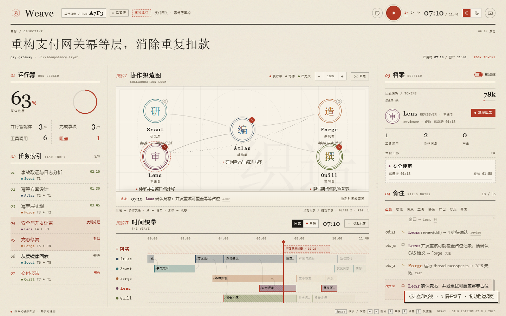
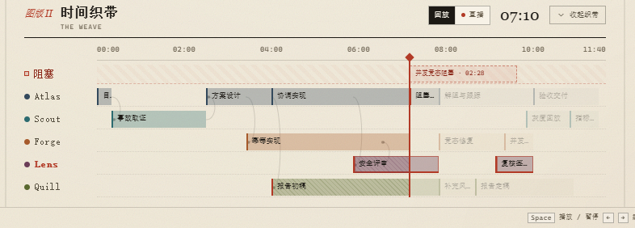
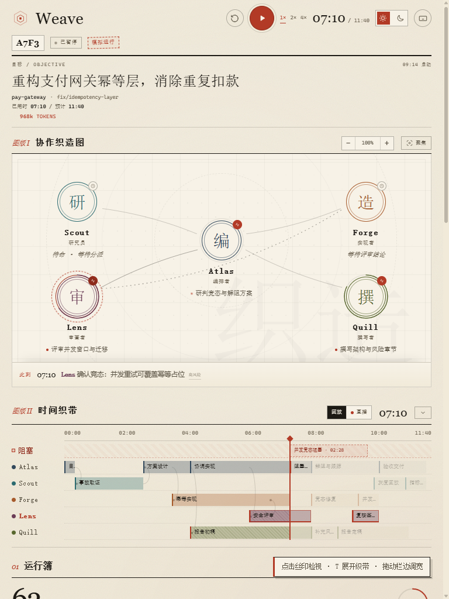
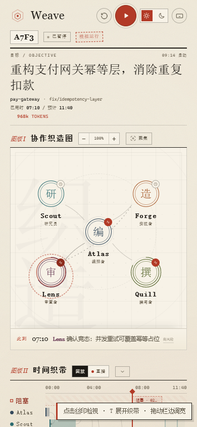

<p></p>

# Weave · 织造观测台

> 多智能体协作观测台 —— 一份让协作过程可观看、可回放的界面原型

[](https://github.com/fanyingnie2163663/weave-observatory/stargazers)
[](LICENSE)
[](https://www.npmjs.com/package/dsh-client-ui-weave)

**Silk Edition 02.8** · 入口：[`v2/index.html`](v2/index.html)

<br clear="all">



---

## 参与

这是一个还在打磨中的视觉与交互原型，**欢迎 Issue 和 PR**：

- **Star**：如果「协作过程可视化」这个方向对你有用，点个 ⭐ 是最直接的支持；
- **真实 trace**：把一次真实多智能体运行按「如何替换数据」的六块映射成 `WEAVE_DATA`，欢迎开 Issue 贴截图或数据（记得脱敏）；
- **PR 欢迎**：视觉 / 交互改进、映射器适配其他 trace 格式（如 Agent Teams、OpenTelemetry）、DSH 插件兼容性修复；
- **本地预览**：无构建步骤，直接改 `index.html` / `v2/index.html` 即可；改插件时跑 `node dsh-client-ui-weave/test-smoke.mjs`。

---

## 1. 它解决什么

多智能体协作的难点往往不是「能力不够」，而是**过程不可见**：

- 只看到最终结果，不知道中间谁做了什么、为什么这样分工；
- 多个智能体并行时，状态散落在各处，很难判断「现在卡在哪」；
- 复盘只能翻日志，很难理解一次阻塞是怎么被发现、上报、解除的。

Weave 把一次协作拆成五个互补的观察层，共用同一根时间轴。三个关键取舍：

1. **确定性回放，而不是实时流。** 所有视图都由虚拟时间 `t` 推导：暂停、拖动、1×/2×/4× 倍速、重播，任何时刻画面都一致——这样「观看」才成立，协作才可讨论、可复盘。
2. **拓扑 + 泳道双视角。** 拓扑回答「关系」，泳道回答「时间」；二者共用一次选择与一个播放头：点击任意节点、泳道或事件，都会同步另外两个视图。
3. **三通道编码状态。** 颜色、图标、文字同时出现（执行中 / 等待中 / 已完成 / 阻塞），不只依赖颜色；每个状态都有可读标签。

另外三个降低认知负担的机制：

- **「此刻」叙事条**：图谱底部持续显示最新事件，像解说一样跟随回放；
- **自动跟随**：默认跟随最新活跃的智能体，也可以随时钉住某一个；
- **聚焦模式**（`F`）：只保留选中智能体及其协作关系，其余淡出。

## 2. 五个观察层

| 观察层 | 回答的问题 | 界面位置 |
|---|---|---|
| 运行目标 | 这次协作要去哪？整体到哪一步了？ | 左栏 · 运行簿 |
| 协作拓扑 | 谁在做什么？谁与谁有协作关系？ | 中央 · 协作织造图 |
| 执行泳道 | 谁在什么时候工作？并行 / 空转 / 阻塞发生在哪？ | 中央 · 时间织带 |
| 事件流 | 刚刚发生了什么？按类型筛选、点击跳转 | 右栏 · 档案 |
| 智能体检视 | 这个智能体此刻的任务、消息、工具与产出 | 右栏 · 检视器 |



演示数据是一场「支付网关幂等层重构」：5 个智能体、7 个工作项、36 条事件、18 次协作消息，运行 11:40，其中包含一次被审查者发现、上报、由编排者裁决的协作阻塞。泳道、事件流与检视器都能回放到这个时刻。

## 3. 交互与快捷键

| 操作 | 效果 |
|---|---|
| `Space` | 播放 / 暂停 |
| `←` / `→` | 后退 / 前进 10 秒（`Shift` 为 60 秒） |
| `1` `2` `4` | 切换播放速度 |
| `R` | 从头重播 |
| `T` | 展开 / 收起时间织带 |
| `F` | 聚焦 / 取消聚焦当前智能体 |
| `G` | 开启 / 关闭自动跟随 |
| `?` | 打开操作指南 |
| 点击节点 | 检视该智能体；关闭自动跟随（钉住） |
| 点击泳道 / 拖动时间轴 | 跳转到该时间点并暂停 |
| 点击任务 | 跳到任务开始时刻并选中负责人 |
| 点击事件 | 回到事件发生时刻并选中执行者 |
| 事件类型筛选 | 全部 / 委派 / 消息 / 工具 / 决策 / 产出 / 发现 / 异常 |
| 直播 / 回放开关 | 头部切换：跟随 live edge，或退出直播自由回放；回看中可一键「回到直播」 |

## 4. 无障碍

- 所有可点击卡片都支持键盘 `Tab` + `Enter` / `Space`；
- 时间轴提供可聚焦的 slider，`aria-valuetext` 会读出当前时刻；
- 状态同时用颜色、图标与文字表达，不只靠颜色；
- 页面尊重 `prefers-reduced-motion`：减少动态时默认暂停，并以静态呈现代替无限装饰动效。

## 5. 如何打开

当前方向是 `v2/index.html`（Silk Edition 02.8，纸本 / 夜色双主题）。纯静态、零依赖、无需构建：双击文件，或用任意静态服务器打开即可。

根目录的 `index.html` 是 Edition 01 深色版，仅作为对比保留。两个入口共用同一份 `data.js` 与 `app.js`，设计说明见 [`v2/README.md`](v2/README.md)。

### 文件结构

```text
index.html            页面骨架、SVG 图标 sprite、无障碍标记（Edition 01 深色版）
styles.css            设计 token、三栏布局、协作图 / 泳道 / 事件流样式、响应式断点
data.js               演示数据（window.WEAVE_DATA：meta / agents / tasks / events / messages / blocker）
app.js                回放引擎、布局计算、渲染与交互（纯 JS，无依赖）
v2/                   Silk Edition：index.html / styles.css / theme.css / live.css / edition.js
docs/shots/           README 配图（hero / lanes / tablet / mobile）
assets/               图标（icon-180 / icon-512 / icon.png）与生成脚本
dsh-client-ui-weave/  DSH 会话视图插件：mapping.mjs 把会话快照映射成 WEAVE_DATA
```

### 窗口适配

- 桌面 **≥1120px**：三栏工作台（目标 / 任务 · 拓扑 / 泳道 · 检视 / 事件）；
- 平板 **761–1120px**：两栏概览 + 全宽图谱，页面纵向滚动；
- 手机 **≤760px**：单列重排为「目标 → 拓扑 → 泳道 → 任务 → 检视 → 事件」，先看到协作战场，再向下看细节；
- v2 在 **≤1360px 或 ≤860px 高度**下会主动收缩装饰性小字与脚注，保证 1264×805 这类非全屏窗口可读。

| 平板 768×1024 | 手机 390×844 |
|:---:|:---:|
|  |  |

## 6. 如何替换数据

`data.js` 暴露 `window.WEAVE_DATA`，把一次运行映射成六块即可复用整套界面：

```js
{
  meta: { duration, playbackSeconds, goal, project, branch, ... },
  agents: [{
    id, name, roleCn, roleEn, icon, color, model,
    work: [{ s, e, label, activity, task }]   // 活跃区间（泳道段）
  }],
  tasks: [{ id, title, owner, start, end, deps }],
  events: [{ t, type, actor, target?, text, tag? }],  // 委派 / 消息 / 工具 / 决策 / 产出 / 发现 / 异常
  messages: [{ t, from, to, travel, tone }],           // 用于粒子与泳道连线
  blocker: { from, to, title, detail }
}
```

- 智能体状态日志 → `agents[].work` 区间；
- 任务板 / todo → `tasks`（含依赖）；
- 工具调用、消息、产物、决策 → `events`；
- 任意两个智能体之间的一次交接 → `messages`（`travel` 控制粒子飞行时长）；
- 阻塞事件 → `blocker` 的时间窗，泳道会画出阻塞带，节点与任务同步告警。

当前进度、并行数、工具调用数、事件流可见条数等，全部由区间在 `t` 上实时推导，不需要后端推送。

## 7. DSH 插件

同一份界面也打包成 DeepSeek Harness 的**会话视图**插件：在聊天 / 轨迹 / 统计之外多一个「织造」标签页。

```bash
dsh plugin add dsh-client-ui-weave
```

它把**真实会话数据**映射进同一套界面——[`dsh-client-ui-weave/src/mapping.mjs`](dsh-client-ui-weave/src/mapping.mjs) 把 DSH 会话快照（turns / events / 子代理投影）转换成 `WEAVE_DATA`，随会话推进、支持回拉；没有会话数据时回退到内置演示数据。

- 源码：[`dsh-client-ui-weave/`](dsh-client-ui-weave/)（MIT）
- npm：[`dsh-client-ui-weave`](https://www.npmjs.com/package/dsh-client-ui-weave)
- 自检：`node dsh-client-ui-weave/test-smoke.mjs`

## 8. 已知边界

- **静态原型默认用模拟数据**：`index.html` / `v2/` 的运行数据来自 `data.js`，可用真实 trace 整体替换；仓库里的 DSH 插件则走真实会话数据（见上一节）；
- **单次运行**：没有多运行对比、跨运行检索；
- **只读观测**：不支持在界面上批准、暂停或重派任务；
- **动效克制**：若需要更强的现场感（例如任务完成微动效、语音解说），需同步提供 `prefers-reduced-motion` 的静态替代。

## License

MIT License · © 2026 聂凡瑛（fanyingnie）
